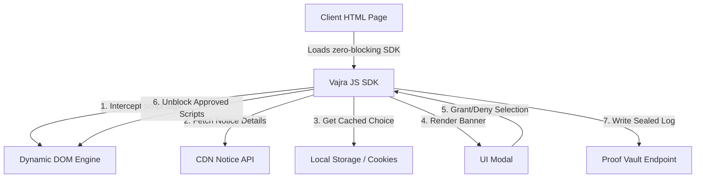
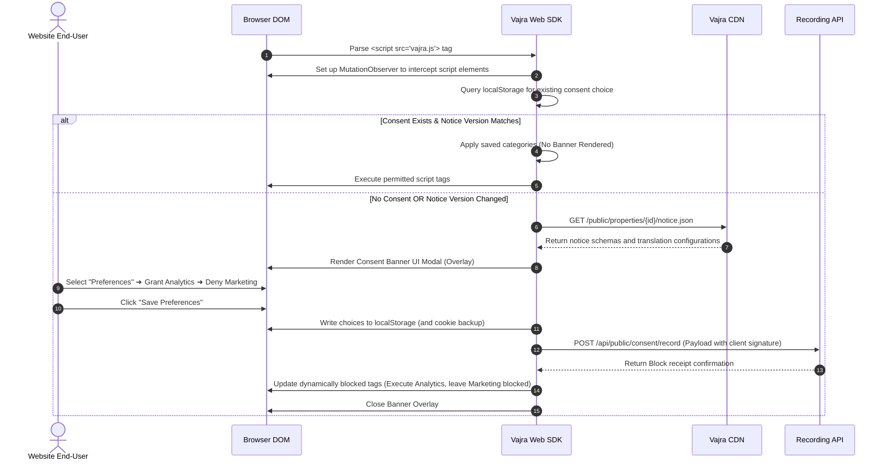

# Vajra — Website Integration Technical Specification

This document serves as the **single source of truth** for the **Website Integration** (JavaScript Web SDK) module of the Vajra DPDPA compliance platform. It provides the detailed frontend, backend, database, integration, and compliance specifications required to build, test, and maintain this module.

---

## 1. Module Overview

### 1.1 Purpose
The **Website Integration** module provides a low-code, asynchronous JavaScript loader script that organizations embed on their websites. The script does two critical tasks:
1. Dynamically renders the DPDPA-compliant **Consent Banner** based on active notice versions and languages.
2. Intercepts, blocks, and conditionally unblocks third-party scripts (e.g. Google Analytics, Facebook Pixel) according to the user's consent decisions.

### 1.2 Business Objective
To allow engineering teams to implement consent compliance in minutes by adding a single `<script>` tag. The script automatically manages the visual interface, cookie consent, and script execution, reporting client preferences back to the central repository.

### 1.3 DPDPA Compliance Objective
*   **Prior Notice (Section 6(3))**: Notice must be given before or at the time of collecting personal data. The SDK ensures that tracker scripts do not write cookies or collect user identifiers before the consent banner is presented and accepted.
*   **Unconditional Consent (Section 6(1))**: The SDK dynamically blocks all non-essential scripts, preventing "consent walls" and ensuring users can access services even if they deny non-essential tracking purposes.

### 1.4 Architectural Context
The SDK loader acts as a middleware gatekeeper between the user's browser, third-party trackers, and the Vajra backend APIs:



### 1.5 Target Users
*   **Web Developers**: Integrate the script, configure block triggers, and map custom tag categories.
*   **Legal & Compliance Officers**: Inspect cookie block status, verify the banner appears correctly, and trace consent logs.

---

## 2. DPDPA Mapping & Compliance Matrix

| DPDPA Section | Regulatory Requirement | Web SDK Implementation |
| :--- | :--- | :--- |
| **Section 6(3)** | Notice must accompany the request for consent. | The SDK fetches the active Notice text and displays it directly inside the consent widget. |
| **Section 6(1)** | Consent must be specific and informed. | Banners render individual checkboxes for processing purposes (e.g., Analytics, Marketing) rather than a blanket opt-in. |
| **Section 6(3)(a)** | Principal has the right to withdraw consent easily. | SDK places a sticky "Consent Preferences" widget on the footer of all pages, allowing one-click revocation. |

---

## 3. End-to-End User Journey



---

## 4. Technical Script Interception Architecture

To ensure compliance under DPDPA, third-party trackers must not fire prior to consent. Vajra implements a **dual-layer interception engine**:

### 4.1 HTML Node Modification (Prior to Execution)
Developers mark third-party scripts with special attributes to prevent auto-execution:
```html
<!-- Native Tag -->
<script type="text/javascript" src="https://example.com/analytics.js"></script>

<!-- Refactored Vajra Tag -->
<script type="text/plain" data-zs-purpose="analytics" data-zs-src="https://example.com/analytics.js"></script>
```
*The browser ignores `<script type="text/plain">` blocks. The SDK parses these nodes and changes the type to `text/javascript` only after consent is granted.*

### 4.2 Dynamic Script Creation Interception (API Override)
To intercept trackers created dynamically by third-party libraries (e.g. `document.createElement('script')`), the SDK overrides the global DOM API before other scripts initialize:

```javascript
(function() {
    const originalCreateElement = document.createElement;
    document.createElement = function(tagName, options) {
        const element = originalCreateElement.call(document, tagName, options);
        if (tagName.toLowerCase() === 'script') {
            // Intercept dynamic script tags
            Object.defineProperty(element, 'src', {
                set: function(url) {
                    const purpose = window.Vajra.matchPurpose(url);
                    if (purpose && !window.Vajra.hasConsent(purpose)) {
                        element.setAttribute('data-zs-blocked-src', url);
                        element.setAttribute('type', 'text/plain');
                        // Prevent source from execution
                        return;
                    }
                    element.setAttribute('src', url);
                },
                get: function() {
                    return element.getAttribute('data-zs-blocked-src') || element.getAttribute('src');
                }
            });
        }
        return element;
    };
})();
```

---

## 5. Web SDK JavaScript Payload Schema

When consent is captured, the SDK compiles user choices and sends a signed payload to the recording endpoint:

```json
{
  "client_token": "zs_prop_e3b0c442",
  "notice_version_id": "c1387d89-9831-419b-a010-8b630f9a2de0",
  "session_id": "8b9e67d4-89d8-4fbb-ba86-fa8ccff88c22",
  "consented_purposes": ["analytics"],
  "denied_purposes": ["marketing"],
  "user_agent": "Mozilla/5.0 (Macintosh; Intel Mac OS X 10_15_7)...",
  "client_signature": "e3b0c44298fc1c149afbf4c8996fb92427ae41e4649b934ca495991b7852b855",
  "fingerprint": "7ac98b11118..."
}
```

---

## 6. Security & Performance Policies

*   **Asynchronous Loading**: The loader script uses the `async` attribute to prevent blocking DOM render trees.
*   **CDN Cache Invalidation**: Notice schemas are cached on Cloudflare/AWS CloudFront edge nodes with a TTL of 3600 seconds. When a Notice version updates, a webhook triggers a CDN purge to ensure clients fetch new banners.
*   **Content Security Policy (CSP)**: The SDK is fully compatible with strict CSP configurations. Organizations must add the following parameters:
    `script-src https://cdn.vajra.in; connect-src https://api.vajra.in`

---

## 7. QA Verification Matrix

### 7.1 Positive Test Cases
*   **TC-01 (Pre-consent blocking)**: Load page for the first time. Verify that scripts marked `data-zs-purpose` remain in `text/plain` format and do not write local storage cookies.
*   **TC-02 (Post-consent unblocking)**: Select "Accept All" in the banner. Verify that the SDK updates types to `text/javascript` and executes the scripts, and that consent results are sent to `/api/public/consent/record`.

### 7.2 Negative Test Cases
*   **TC-03 (Dynamic script blocker escape)**: Trigger a script using `document.body.appendChild` injecting a marketing tracker. Ensure the SDK overrides match the URL filter, changes the type to `text/plain`, and blocks execution.
*   **TC-04 (Offline Resilience)**: Block backend API endpoints via mock proxies. Grant consent in the banner. Verify the SDK caches the selection locally and queues the API payload to be sent when connections return.
