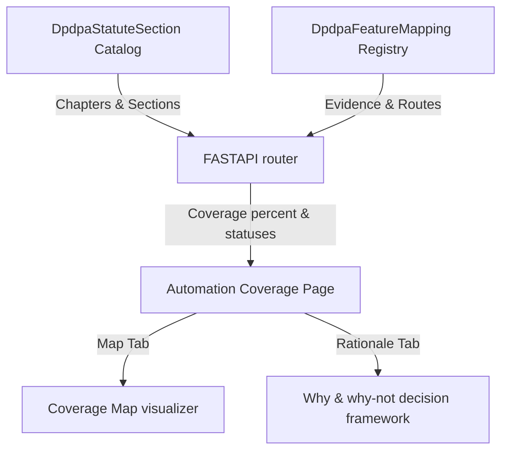
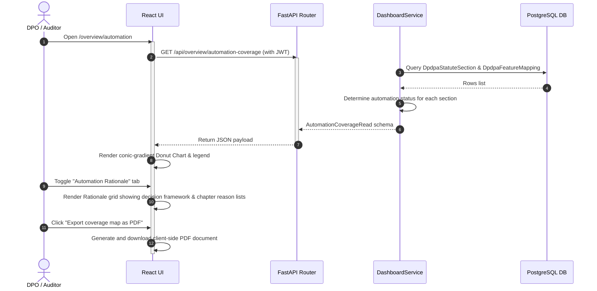
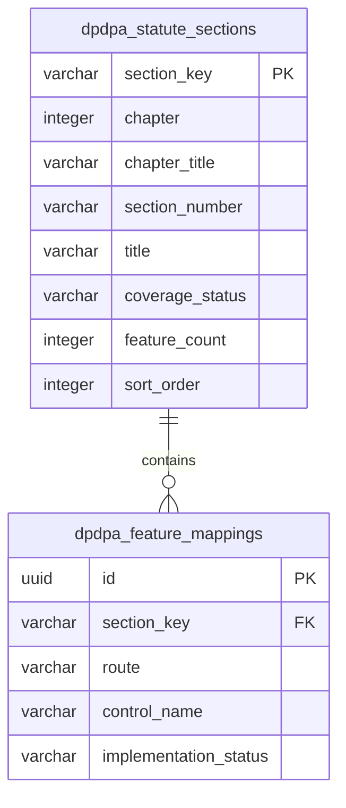

# DPDPA Shield — Automation Coverage Technical Specification

This document serves as the **single source of truth** for the **Automation Coverage** module of the ZeroShield DPDPA compliance platform. It provides the detailed frontend, backend, database, integration, and compliance specifications required to build, test, and maintain the automation coverage visualization.

---

## 1. Module Overview

### 1.1 Purpose
The **Automation Coverage** module maps the active software features and services of the ZeroShield platform against the requirements of the Digital Personal Data Protection Act, 2023 (DPDPA). It provides a structured visual map classification (Fully Automated, Partially Automated, Manual/Advisory, and Not Applicable) to define how compliance operations are performed across the organization.

### 1.2 Business Objective
To demonstrate to internal stakeholders, corporate boards, and regulatory auditors the extent to which the organization uses programmatic safeguards and automated pipelines to enforce compliance, minimizing human error and operational overhead.

### 1.3 DPDPA Compliance Objective
*   Provides proof of compliance capabilities for **Section 6(10) (burden of proof)** and **Section 8 (Data Fiduciary obligations)**.
*   Enables ongoing compliance capability verification for audits by the **Data Protection Board of India (DPBI)**.

### 1.4 Architectural Context
The Automation Coverage engine aggregates DPDPA statute database schemas and maps them dynamically to registered system features and their evidence states:



### 1.5 Target Users
*   **CISOs and IT Security Directors**: Oversee technical automation targets and configure system-level security integrations.
*   **Compliance Officers and Auditors**: Document evidence pipelines, audit chapter-by-chapter mapping matrices, and export PDF compliance summaries.

---

## 2. Decision Framework

To classify each section's compliance status, DPDPA Shield evaluates sections against a fixed set of **automation drivers** (why we automate) and **non-automation constraints** (why we cannot fully automate):

### 2.1 Automation Drivers (A1 - A5)
*   **A1: Deterministic & Repeatable**: A rule-based operation with no ambiguity (e.g. hashing a record).
*   **A2: Clear Statutory Trigger**: A defined event fires the action (e.g., user opt-out triggers erasure).
*   **A3: Platform Controls the Data**: The records, identities, or configurations reside within the platform database boundaries.
*   **A4: Prescribed-Format Artifact**: The output is a templated document (e.g., notice summaries, audit receipts).
*   **A5: Quantifiable / Measurable**: The duty can be scored or timed (e.g. DSAR SLA tracking).

### 2.2 Non-Automation Constraints (N1 - N10)
*   *Addressable limits (automatable over time)*:
    *   **N1: Legal Judgment Required**: Legal counsel must review exemptions, lawful bases, or undertakings.
    *   **N2: Customer-Side Infrastructure**: The control lives in the customer's own network, host environment, or key manager.
    *   **N3: External System or Third Party**: Requires third-party engagement (e.g., external independent auditor, external data processor updates).
    *   **N4: Human Verification Event**: Requires real-world validation of events (e.g. proof of death or incapacity for nominations).
    *   **N5: Pending Government Notification**: Awaits a notified list or rule (e.g. restricted cross-border transfer countries list).
*   *Outside the Fiduciary's remit (structural)*:
    *   **N6: Binds the Board / Government**: Governs the regulator or Central Government.
    *   **N7: Legal / Judicial Process**: Run by courts and legal counsel (appeals, dispute mediation).
    *   **N8: Duty on the Data Principal**: The obligation falls on the individual user, not the organization.
    *   **N9: Reactive to Authority Request**: Only fires upon DPBI request (e.g. power to call for information).
    *   **N10: Definitional / Scope Only**: Sets definitions or application boundaries (no operative fiduciary duty).

---

## 3. End-to-End User Journey



### 3.1 Scenario Workflows
*   **Coverage Map Inspection**:
    *   The DPO opens the dashboard, verifies the overall coverage percentage gauge, and scrolls through the chapter rows.
    *   To configure a specific section, the DPO clicks a status pill (e.g. "Automated" pill on S.5 Notice or S.6 Consent) and is redirected to the corresponding configuration module page (e.g. `/consent/notices`).
*   **Auditor Assessment**:
    *   An auditor navigates to the **Automation Rationale** tab to review why S.10 (Significant Data Fiduciary duties) is marked "Partial" (noted as `N3` due to external auditor requirements) or why Ch V (DPBI rules) is marked "Not in scope" (`N6`).

---

## 4. Detailed Screen Specification

The Automation Coverage page (Route: `/overview/automation`) contains two primary tabs:

### 4.1 Header Metrics
*   **Coverage Gauge**: Conic gradient donut rendering the coverage percentage:
    $$\text{Coverage Percentage} = \frac{\text{Fully} + \text{Partial} \times 0.5}{\text{Total Section Obligations} - \text{Not Applicable}} \times 100$$
*   **Legend Stats**: Summary counters for Fully Automated (Green), Partially Automated (Yellow), Manual/Advisory (Gray), and Not Applicable.

### 4.2 Tab 1: Coverage Map
*   Displays the **Act Coverage — Chapter by Chapter** table.
*   Each chapter row displays a chapter header with a capsule showing Chapter summary details (e.g. `6 automated · 5 partial`).
*   Expanding a chapter displays individual section rows:
    *   *Columns*: Section number (e.g. `S.8(7)`), Section title (e.g. `Erasure & retention limits`), Mapped platform features description (e.g. `2 mapped platform features`), and the Status Pill (Automated, Partial, Manual, Not in scope).
    *   *Action*: Click the status pill to navigate to its configuration route.

### 4.3 Tab 2: Automation Rationale
*   **Decision Framework**: Renders card grids highlighting the five **Automation Drivers** (`A1` to `A5`) and ten **Non-Automation Constraints** (`N1` to `N10`).
*   **Why-Not Reason Trackers**: Horizontal bar chart summarizing the volume of sections mapped to each driver/constraint category.
*   **Detailed Rationale List**: Detailed section-by-section breakdown displaying the specific logic description and category tag codes (e.g., Section 4: tagged with `A1` and `N1`, status is `Partial`).

---

## 5. Data Schemas

### 5.1 AutomationCoverageRead Schema

| Field Name | Type | Description | Example Value |
| :--- | :--- | :--- | :--- |
| `coverage_percent` | Integer | Calculated coverage percentage | `64` |
| `fully_automated` | Integer | Sections classified as fully automated | `10` |
| `partial` | Integer | Sections classified as partially automated | `7` |
| `manual` | Integer | Sections classified as manual/advisory | `3` |
| `not_applicable` | Integer | Sections outside of fiduciary scope | `14` |
| `total_sections` | Integer | Total sections cataloged | `34` |
| `chapters` | List | Summary stats for each chapter | See below |
| `sections` | List | Detailed row classifications | See below |
| `rationale_counts` | Dict | Maps status codes to section count | `{"fully_automated": 10}` |

---

## 6. Frontend Architecture

### 6.1 Page Component Structure
```
AutomationCoverage.tsx (Main Page Container)
  └── ConsentManagementGate
        ├── tabbar (Map vs Why toggle)
        ├── CoverageMapTab.tsx (Active when activeTab === 'map')
        │     ├── conic-gradient donut element
        │     ├── legend chips
        │     └── chapter accordion rows
        ├── RationaleTab.tsx (Active when activeTab === 'why')
        │     ├── Drivers / Constraints grids
        │     ├── Reason bars chart
        │     └── Chapter reasoning list rows
        └── Footer actions (Export PDF, Share link)
```

---

## 7. Backend Architecture

### 7.1 Aggregation Logic
*   **Endpoint**: `GET /api/overview/automation-coverage` mapped in `app/routers/overview.py`.
*   **Service Method**: `DashboardService.get_automation_coverage()`.
*   *Logic*:
    1.  Fetches all entries from the `DpdpaStatuteSection` catalog sorted by `sort_order`.
    2.  Fetches all mappings from `DpdpaFeatureMapping`.
    3.  Iterates through sections and maps features:
        *   If `coverage_status == na` ➜ status is `na`.
        *   If features exist and all are marked `implemented` ➜ status is `fully`.
        *   If features exist and at least one is `implemented` ➜ status is `partial`.
        *   Else ➜ status is `manual`.
    4.  Aggregates stats per chapter and calculates the final coverage percentage.

---

## 8. Database Design



---

## 9. QA Verification Matrix

### 9.1 Positive Test Cases
*   **TC-AC-01 (Donut Chart Calculation)**: Verify that loading the page computes correct conic-gradient degree angles based on backend counts.
*   **TC-AC-02 (PDF Export Layout)**: Verify that clicking "Export PDF" compiles valid metadata rows and downloads the coverage PDF document.
*   **TC-AC-03 (Row Navigation)**: Assert clicking the Status Pill button on a row successfully navigates the React router wrapper to the correct feature path.

### 9.2 Negative Test Cases
*   **TC-AC-04 (Empty Feature Mapping)**: Drop all rows from the `dpdpa_feature_mappings` database. Verify that all applicable sections fall back to "Manual" status and overall coverage percent resolves to `0%` without server exceptions.
*   **TC-AC-05 (Tab Switching Performance)**: Toggle between 'map' and 'why' tabs rapidly. Assert the browser layout renders instantly without state loops or unmounted component memory leaks.
