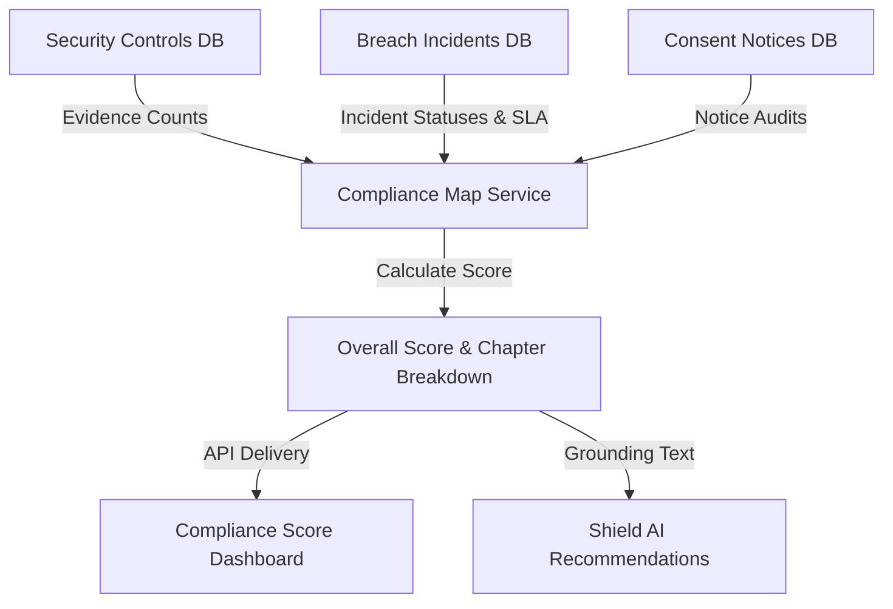
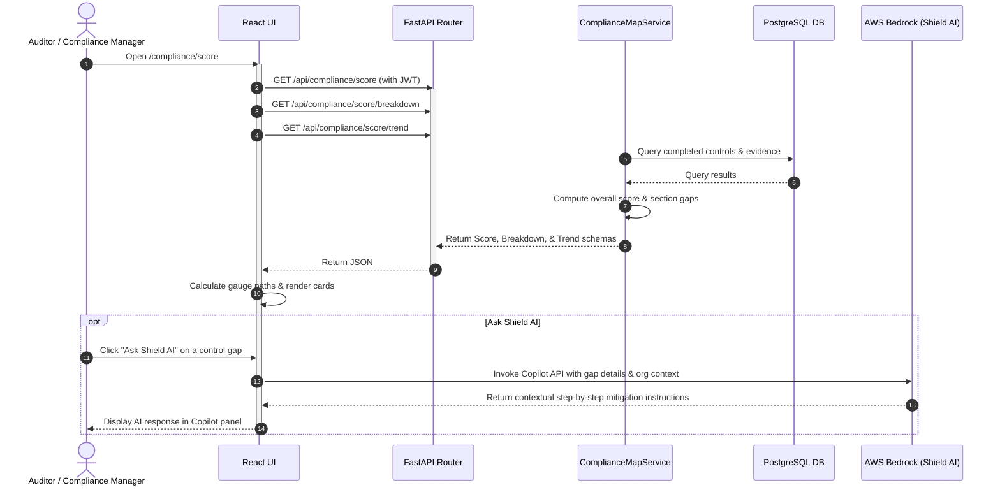
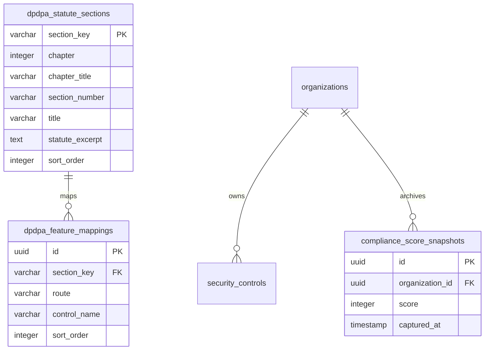

# DPDPA Shield — Compliance Score Technical Specification

This document serves as the **single source of truth** for the **Compliance Score** (Compliance Posture Deep Dive) module of the ZeroShield DPDPA compliance platform. It provides the detailed frontend, backend, database, integration, and compliance specifications required to build, test, and maintain the compliance scoring logic and UI.

---

## 1. Module Overview

### 1.1 Purpose
The **Compliance Score** module calculates and details the organization's legal alignment posture under the Digital Personal Data Protection Act, 2023 (DPDPA). It provides a penalty-anchored compliance percentage, a section-by-section audit checklist, historical compliance trends, and Shield AI recommendations for closing control gaps.

### 1.2 Business Objective
To provide corporate boards, legal counsel, and security teams with an audit-ready, quantifiable compliance score that highlights immediate statutory penalty risks, operational gaps, and exact corrective actions.

### 1.3 DPDPA Compliance Objective
*   Provides structured compliance reporting for **Section 8 obligations** (Data Fiduciary obligations, reasonable security practices).
*   Facilitates ongoing self-auditing of compliance controls as expected by the **Data Protection Board of India (DPBI)**.
*   Enforces accountability by translating missing operational controls into statutory penalty liabilities (up to ₹250 Crores per violation).

### 1.4 Architectural Context
The Compliance Score engine processes raw evidence from security safeguards, breach records, data inventories, and consent notices, mapping completion statuses to the statutory chapters of the DPDPA:



### 1.5 Target Users
*   **Chief Compliance Officers / Legal Counsel**: Audit DPDPA compliance details, inspect statute excerpts, and review statutory penalty exposure.
*   **CISOs & DPOs**: Identify outstanding control gaps, retrieve remediation checklists, and consult Shield AI for step-by-step resolution.
*   **External Auditors**: Inspect verification evidence, audit trail trends, and export PDF compliance reports.

---

## 2. DPDPA Mapping & Compliance Matrix

| DPDPA Chapter | Statute Scope | Compliance Score Mapping |
| :--- | :--- | :--- |
| **Chapter II** | Obligations of Data Fiduciary (Sections 5 - 8). | Evaluates Consent Notices status, RoPA processing mappings, child data filters, and breach response readiness. |
| **Chapter III** | Rights and Duties of Data Principals (Sections 11 - 13). | Tracks DSAR request intake workflows, correction/erasure mechanisms, and response SLA durations. |
| **Chapter IV** | Special Obligations (Section 10 - Significant Data Fiduciary). | Validates appointment of DPOs, independent auditors, and periodic DPIA audits. |
| **Chapter V** | Transfer of Personal Data Outside India (Section 16). | Assesses cross-border transfer registries and data processor data protection agreements (DPAs). |
| **Chapter VIII** | Penalties & Adjudication (Schedule 1). | Maps missing controls to statutory penalty schedules (e.g. ₹250 Cr for breach prevention failure). |

---

## 3. End-to-End User Journey



### 3.1 Scenario Workflows
*   **Recalculation Flow**:
    *   Administrator triggers "Recalculate".
    *   `ComplianceMapService` recompute queries are launched (checking safeguards table, checking audit logs, auditing consent templates, auditing breach logs).
    *   The overall score is recompiled, and `last_calculated_at` is updated.
*   **Auditor Verification Flow**:
    *   An auditor opens the page, reviews the section-by-section table, expands a row (e.g. Section 8(5) - reasonable security safeguards) to view mapped security controls, clicks "Configure" to jump to evidence source, and clicks "Export Report" to generate an offline PDF report.

---

## 4. Detailed Screen Specification

The Compliance Score Deep Dive interface (Route: `/compliance/score`) contains four core widgets:

1.  **Overview Hero Panel**:
    *   **Large SVG Compliance Gauge**: Displays the overall score percentage with status badges (`Good Standing` for score >= 80, `Needs Attention` for 60-79, `At Risk` for < 60).
    *   **KPI Stat Cards**: Score change this week (`+X pts`), Penalty Exposure chips (₹150 Cr mitigated vs ₹250 Cr worst case), and Days since last incident tracker.
2.  **DPDPA Section-by-Section Accordion Table**:
    *   Lists all registered DPDPA statute chapters and sections.
    *   *Columns*: Section reference (e.g., Section 8(5)), Section Title, Score Mini-Gauge, Complete/Total Controls ratio, Max Statutory Penalty Exposure, Status Badge (Compliant, Minor Gap, At Risk).
    *   *Expanded Row Details*: Renders the official DPDPA statute legal excerpt, a list of mapped compliance controls (with check/cross indicators), a "Configure" link to the evidence source, and an "Ask Shield AI" helper button.
3.  **Trend & Benchmark Charts**:
    *   **Compliance Trend (Line Graph)**: Plots the historical compliance score percentage over the last 90 days. Displays vertical event annotation markers (e.g. "Fixed S.8(5) gap" trigger dates).
    *   **Industry Benchmark Card**: Renders the organization's current score against the industry median bar chart.
4.  **Shield AI Insights Recommendations Card**:
    *   Injects active compliance context (gaps list, weakest chapters, industry segment) into the LLM system prompt.
    *   Displays a list of the top 3 recommended priority corrective actions with instant clickable buttons to launch the AI Copilot.
5.  **Auditor Action Sticky Footer**:
    *   Contains buttons to:
        *   "Export this report as PDF" (triggers client-side `scorePdf.ts` document generation).
        *   "Share with auditor" (copies read-only link to clipboard).
        *   "Schedule monthly auditor email" (triggers draft mail template).

---

## 5. Scoring Formulas & Metrics

> **Authoritative calculation reference:** [compliance_score_calculation.md](./compliance_score_calculation.md) documents the **live implementation** (penalty-weighted section scores, five evidence routes, RoPA deductions, penalty exposure). That document **supersedes** the outdated **Base Score − Risk Deductions** description in §5.1 below, which is retained for historical context only.

### 5.1 Posture Score Calculation
The overall posture score is computed out of 100 based on mapping elements:
$$\text{Compliance Score} = \text{Base Score} - \text{Risk Deductions}$$

*   **Base Score**: Ratio of completed security controls and active policy declarations configured inside the compliance maps.
*   **Risk Deductions**:
    *   **Breach Penalties**: Deduct 15 points for every unresolved, active breach incident.
    *   **SLA Violations**: Deduct 5 points for every DSAR request that has exceeded its statutory response deadline without resolution.
    *   **Missing DPO Details**: Deduct 10 points if no active workspace DPO or grievance officer is configured.

### 5.2 Penalty Exposure Indices
Penalty calculations match Schedule 1 of the DPDPA, 2023:
*   **Breach Prevention Failure**: Worst case ₹250 Crores.
*   **Failure to notify Board/Principals of breach**: Worst case ₹150 Crores.
*   **Failure to comply with child data obligations**: Worst case ₹150 Crores.
*   **Failure to respond to Data Principal Rights**: Worst case ₹50 Crores.

---

## 6. Frontend Architecture

### 6.1 Page Component Structure
```
ComplianceScoreDeepDive.tsx (Main View Container)
  └── ConsentManagementGate
        ├── SVG Large Gauge (Stroke dasharray animation)
        ├── PenaltyChip.tsx
        ├── Section Accordion Row
        │     ├── Mini Gauge SVG
        │     ├── Statute Excerpt Panel
        │     └── Mapped Controls Status Row
        ├── Trend Line Chart SVG (Polyline data graph)
        ├── Benchmark Bar Chart
        ├── ShieldAICard.tsx (AI Action Card)
        └── Auditor Actions Sticky Bar
```

---

## 7. Backend Architecture

### 7.1 Files & Modules Layout
*   **Router**: `app/routers/compliance.py` maps the `/score`, `/score/breakdown`, `/score/trend`, and `/score/recalculate` endpoints.
*   **Service**: `app/services/compliance_map_service.py` runs queries against `DpdpaStatuteSection`, `DpdpaFeatureMapping`, `SecurityControl`, and `BreachIncident` models to build scoring breakdowns.

---

## 8. Database Design



---

## 9. API Design

### 9.1 Fetch Compliance Score Breakdown
*   **Method / Route**: `GET /api/compliance/score/breakdown`
*   **Response Body (200 OK)**:
    ```json
    {
      "sections": [
        {
          "section_key": "sec_8_5_security",
          "title": "Obligation to Protect Personal Data",
          "statute_reference": "Section 8(5)",
          "score": 75,
          "status": "minor",
          "controls_completed": 3,
          "controls_total": 4,
          "penalty_crores": 250,
          "configure_route": "/security/safeguards",
          "gaps": [
            {
              "label": "Implement database-level encryption at rest",
              "severity": "medium"
            }
          ],
          "controls": [
            {
              "name": "Audit log tamper protection configured",
              "complete": true,
              "configure_route": "/security/safeguards"
            }
          ],
          "statute_excerpt": "A Data Fiduciary shall protect personal data in its possession or under its control..."
        }
      ]
    }
    ```

---

## 10. QA Verification Matrix

### 10.1 Positive Test Cases
*   **TC-CS-01 (Score Calculation Accuracy)**: Verify that completing a security control changes the section score and updates the overall posture score upon recalculation.
*   **TC-CS-02 (PDF Export Integrity)**: Assert clicking "Export PDF" compiles valid JSON payloads and invokes the `scorePdf` rendering engine without throwing runtime errors.
*   **TC-CS-03 (SLA Penalty Impact)**: Set a DSAR request to overdue. Recalculate score. Verify compliance score decreases by exactly 5 points and penalty exposure updates.

### 10.2 Negative Test Cases
*   **TC-CS-04 (Unauthorized Recalculation)**: Attempt to hit `/api/compliance/score/recalculate` with a `viewer` role token. Verify response is `403 Forbidden`.
*   **TC-CS-05 (Missing DB Chapter Seeds)**: Truncate `dpdpa_statute_sections` table in test environment. Verify the API degrades gracefully, returning empty sections rather than a 500 Server Error.
*   **TC-CS-06 (Trend Calculation Limits)**: Request `/api/compliance/score/trend?days=400` (exceeding maximum 365 days validator). Ensure API returns a `422 Unprocessable Entity` validation error.
