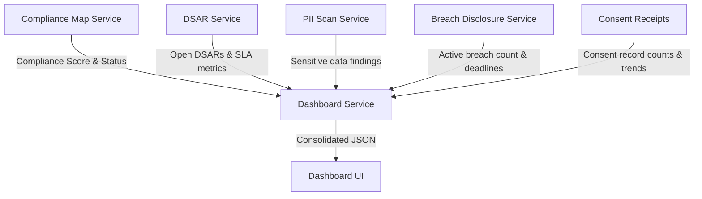
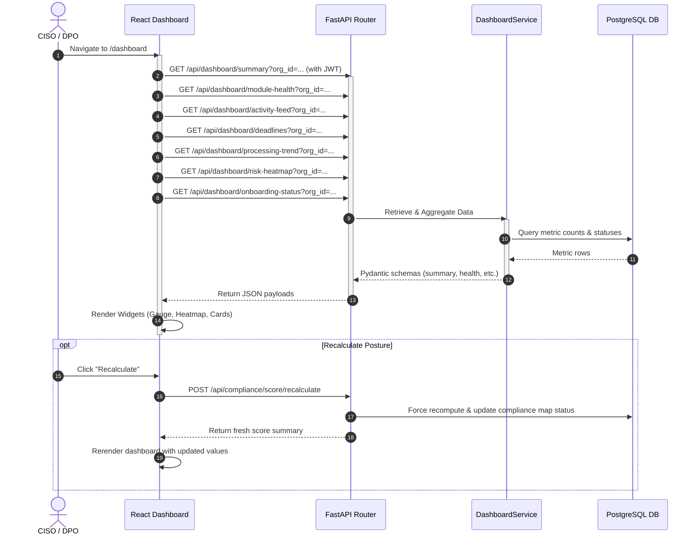
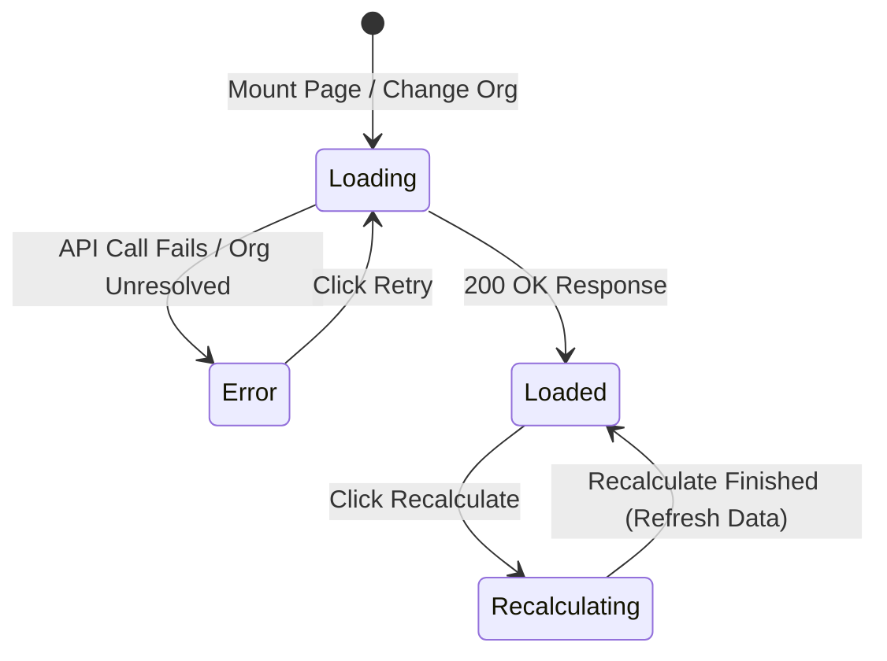
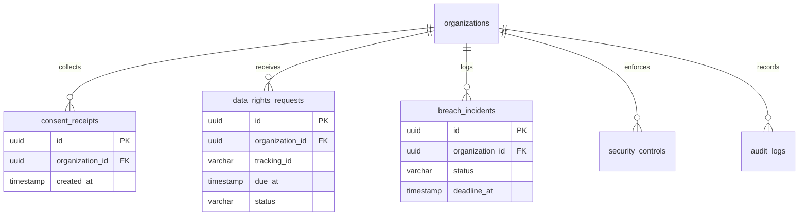

# DPDPA Shield — Dashboard Technical Specification

This document serves as the **single source of truth** for the **Dashboard** module of the ZeroShield DPDPA compliance platform. It provides the detailed frontend, backend, database, integration, and compliance specifications required to build, test, and maintain the dashboard interface.

---

## 1. Module Overview

### 1.1 Purpose
The **Dashboard** module serves as the primary CISO Command Center and compliance landing page. It aggregates metrics from all subsystems of the ZeroShield DPDPA platform (Consent, DSAR, Safeguards, PII Scanner, Audit Log, Breaches) to provide a unified posture overview.

### 1.2 Business Objective
To empower compliance executives, Data Protection Officers (DPOs), and administrators with real-time insight into the organization's compliance posture, highlighting critical risks, immediate actions, SLA breaches, and financial penalty exposure.

### 1.3 DPDPA Compliance Objective
*   Provides centralized monitoring of **burden of proof** items (Section 6(10) - proof of consent).
*   Enforces oversight on **grievance redressal timelines** (Section 11 - responding to DSARs).
*   Tracks status of **security safeguards** (Section 8(5) - reasonable security practices).
*   Monitors and tracks **breach response readiness** (Section 8(6) - obligation to notify Board and principals of data breaches).

### 1.4 Architectural Context
The Dashboard is a high-level aggregation layer that queries and maps data from other domain services:



### 1.5 Target Users
*   **Chief Information Security Officers (CISOs)**: Review overall posture trends, risk heatmaps, and security safeguards.
*   **Data Protection Officers (DPOs)**: Check onboarding progress, active compliance alerts, pending DSAR SLA deadlines, and consent withdrawal rates.
*   **Superadmins**: Switch tenant context and monitor multi-organization posture matrices.

---

## 2. DPDPA Mapping & Compliance Matrix

| DPDPA Section | Regulatory Requirement | Dashboard Implementation |
| :--- | :--- | :--- |
| **Section 5 & 6** | Obligation to obtain informed consent under notice. | **Consent Records** metric card and **Withdrawal Rate** sidebar KPI monitor active compliance volume. |
| **Section 8(5)** | Duty to protect personal data with reasonable security safeguards. | **Security Safeguards** module health score and **Risk Heatmap** reflect active control configurations. |
| **Section 8(6)** | Duty to report personal data breaches to the Board and affected data principals. | **Active Incidents** metric card and **Upcoming Deadlines** track open breach notification periods. |
| **Section 9** | Obligation regarding processing of children's personal data. | **Onboarding Alerts** trigger warnings if child data records exist without verified guardian consent. |
| **Section 11, 12 & 13** | Rights of Data Principals (Access, Correction, Grievance Redressal). | **Open DSARs** metric card and **Avg DSAR Response** sidebar KPI track SLA adherence. |

---

## 3. End-to-End User Journey



### 3.1 Scenario Workflows
*   **First-Time Login (Onboarding)**:
    *   System checks workspace properties. If details are missing, the `AlertBanner` is displayed at the top, warning the DPO to complete profile info or configure child data checks.
*   **SLA Warning Flow**:
    *   If a DSAR is close to breaching its regulatory SLA or a breach notification window is expiring, a critical alert appears in the **Upcoming Deadlines** widget.
*   **Superadmin Context Selection**:
    *   Superadmins are presented with an organization dropdown. Selecting a tenant organization updates the local storage context and forces all dashboard endpoints to refresh using the chosen `org_id` query parameter.

---

## 4. Detailed Screen Specification

The Dashboard page (Route: `/dashboard`) follows a structured multi-widget dashboard format:

1.  **Onboarding Alerts Banner (Sticky Header)**:
    *   *UI Component*: Toast-style warning bar at the top of the viewport.
    *   *Data Source*: `/api/dashboard/onboarding-status`.
    *   *Actions*: Click "Configure" to navigate to the target module path; click "Dismiss" to hide locally.
2.  **Hero Gauge & Posture Status Card**:
    *   *UI Component*: Left side: Circular SVG gauge rendering the compliance score (0-100) and status badge (Good Standing, Needs Attention, At Risk). Right side: Key metric text, GDPR readiness placeholder, and penalty exposure chips (mitigated vs worst case).
    *   *Actions*: Clicking the gauge navigates to `/compliance/score`. Clicking "Recalculate" triggers score re-evaluation. Clicking "Export Report" downloads a PDF summary.
3.  **KPI Metric Cards (4 Grid Layout)**:
    *   *Cards*: Consent Records, PII Findings, Open DSARs, Active Incidents.
    *   *Validation/Styling*: Red highlighting if active breach incidents > 0. Yellow warning if open DSARs have pending SLA alerts.
    *   *Action*: Click cards to navigate to respective detail modules (e.g. `/consent/proof-vault`).
4.  **Module Health Grid**:
    *   *UI Component*: Table showing 5 core modules (Consent Management, Security Safeguards, Data Principal Rights, PII Scanner, DPDPA Map) with progress bar, status, and gap count.
    *   *Action*: Clicking a row redirects the user to the configure path.
5.  **Compliance Trend & Upcoming Deadlines (Split Row)**:
    *   *Compliance Trend*: Displays compliance score history trend (60% width).
    *   *Upcoming Deadlines*: List of urgent items (DSAR SLAs, Breach notifications) sorted by due date (40% width).
6.  **Data Processing Chart**:
    *   *UI Component*: Line/bar chart displaying consents collected, DSARs, and integration events over a 6-month window.
7.  **Risk Heatmap**:
    *   *UI Component*: Grid showing categories (Consent, Rights, Security, Breach, Data, Governance) mapped to risk severity (Low, Medium, High, Critical).
8.  **Activity Feed & Sidebar KPIs**:
    *   *Activity Feed*: Merged audit logs and DSAR events in descending chronological order.
    *   *Sidebar KPIs*: Interactive cards showing Avg DSAR response (days), Data processors count, and Withdrawal rate percentage.

---

## 5. Data Schemas

### 5.1 DashboardSummaryRead Schema

| Field Name | Type | Description | Example Value |
| :--- | :--- | :--- | :--- |
| `organization_id` | UUID | Scope identifier | `"5fdc2e17-b70d-45db-9580-ff6df710c01a"` |
| `organization_name`| String | Scoped organization name | `"Acme Corp India"` |
| `compliance_score` | Integer | Overall DPDPA score percentage | `84` |
| `compliance_status`| String | Text badge representing score tier | `"Good Standing"` |
| `penalty_mitigated_crores` | Integer | Estimated penalty amount avoided | `150` |
| `penalty_worst_crores` | Integer | Maximum possible statutory penalty | `250` |
| `score_delta_week` | Integer | Compliance score change in 7 days | `4` |
| `last_calculated_at` | DateTime | Timestamp of calculation | `"2026-06-25T13:00:00Z"` |
| `metric_cards` | List | 4 metric cards data | See below |
| `sidebar_kpis` | List | 3 sidebar KPIs data | See below |

---

## 6. Lifecycle & Transitions

The dashboard does not transition states in a database ledger directly. Instead, it manages client-side data queries and caches calculations:



*   **Caching Strategy**: Summary score details are cached on the server inside the DPDPA map registry. The recalculate action invalidates this cache and updates calculations by scanning database tables.

---

## 7. Relationships with Other Modules

*   **Consent Management**: Supplies total consent receipts (`ConsentReceipt` table) and notice status metrics.
*   **Data Principal Rights**: Supplies active DSAR request logs (`DataRightsRequest` table) and response SLA deadlines.
*   **Security Safeguards**: Supplies completed security controls counts (`SecurityControl` table) to feed the safeguards score card.
*   **PII Scanner**: Supplies total open high-risk findings for the metric card.
*   **Audit Logs**: Provides audit entries to build the recent activity feed.

---

## 8. Frontend Architecture

### 8.1 Page Component Structure
```
Dashboard.tsx (Route Wrapper)
  └── ConsentManagementGate (Superadmin Tenant Selector Gate)
        ├── AlertBanner.tsx (Sticky warning headers)
        ├── ComplianceGauge.tsx (Circular SVG widget)
        ├── PenaltyChip.tsx (Red/Green penalty indicators)
        ├── MetricCard.tsx (KPI metric block)
        ├── ModuleHealth.tsx (Status grid displaying checklist completion)
        ├── ComplianceTrend.tsx (Chart showing progress)
        ├── UpcomingDeadlines.tsx (List of due dates)
        ├── DataProcessingChart.tsx (Consent vs DSAR trends)
        ├── RiskHeatmap.tsx (Grid of system risks)
        ├── RecentActivity.tsx (Merged audit logs list)
        └── CopilotPanel.tsx (Floating AI assistant shell)
```

---

## 9. Backend Architecture

### 9.1 Files & Modules Layout
*   **Router**: `app/routers/dashboard.py` handles parsing requests, permissions validation, and tenant scoping.
*   **Service**: `app/services/dashboard_service.py` runs sub-queries across PII, DSAR, Consent, and Safeguards databases, merging them into unified schemas.

### 9.2 Service Logic (Aggregation Details)
*   **Compliance Score**: Fetches directly from `ComplianceMapService.get_summary()`.
*   **Average DSAR Response**: Extracted from average resolution times of closed requests in the DSAR database.
*   **Withdrawal Rate Calculation**:
    $$\text{Withdrawal Rate} = \frac{\text{ProofVaultRecord.event\_type = 'consent\_withdrawal'}}{\text{Total ConsentReceipts}} \times 100$$

---

## 10. Database Design



---

## 11. API Design

### 11.1 Fetch Dashboard Summary
*   **Method / Route**: `GET /api/dashboard/summary`
*   **Query Parameters**:
    *   `org_id`: UUID (Optional, mandatory for superadmins)
*   **Response Body (200 OK)**:
    ```json
    {
      "organization_id": "5fdc2e17-b70d-45db-9580-ff6df710c01a",
      "organization_name": "Acme Corp India",
      "compliance_score": 84,
      "compliance_status": "Good Standing",
      "penalty_mitigated_crores": 150,
      "penalty_worst_crores": 250,
      "score_delta_week": 4,
      "last_calculated_at": "2026-06-25T13:00:00Z",
      "metric_cards": [
        {
          "key": "consents",
          "label": "Consent Records",
          "value": "12,450",
          "trend": "+12% this month",
          "trend_direction": "up",
          "route_path": "/consent/proof-vault"
        }
      ],
      "sidebar_kpis": [
        {
          "key": "dsar_response",
          "label": "Avg DSAR response",
          "value": "4.2 days",
          "route_path": "/rights/tracker"
        }
      ]
    }
    ```

---

## 12. Security & Compliance Requirements

*   **Role-Based Access Control (RBAC)**:
    *   `admin`, `superadmin`, and `viewer` roles have full read access to dashboard endpoints.
    *   Only `admin` and `superadmin` roles can trigger a manual `POST /api/compliance/score/recalculate`.
*   **Tenant Scoping**: All API calls must resolve the organization ID using the utility method `_resolve_org_id(user, org_id)`. Superadmins must explicitly supply the query parameters, otherwise the API returns `403 Forbidden`.

---

## 13. QA Verification Matrix

### 13.1 Positive Test Cases
*   **TC-DB-01 (Load Dashboard)**: Verify that hitting `/api/dashboard/summary` for a valid organization returns a populated payload with valid metric cards.
*   **TC-DB-02 (Recalculate Posture)**: Assert that trigger recalculate updates the timestamp and refreshes the compliance score.
*   **TC-DB-03 (Tenant Scoping)**: Verify superadmin with valid `org_id` parameters loads metrics scoped only to that target tenant organization.

### 13.2 Negative Test Cases
*   **TC-DB-04 (Superadmin Missing Tenant Context)**: Hit dashboard endpoints as superadmin without passing `org_id`. Assert API returns `403 Forbidden` with detailed error message.
*   **TC-DB-05 (Invalid Tenant ID)**: Hit endpoints with non-existent UUID `org_id`. Assert response is `404 Not Found` or `403 Forbidden` depending on membership.
*   **TC-DB-06 (Recalculate RBAC Guard)**: Send `POST /api/compliance/score/recalculate` using a `viewer` token. Verify that server returns `403 Forbidden`.
