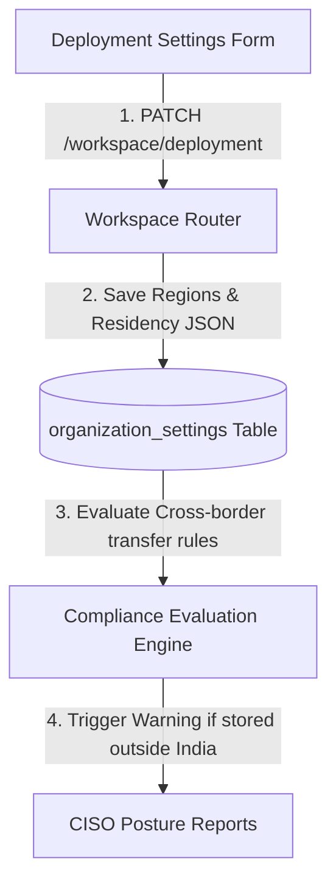
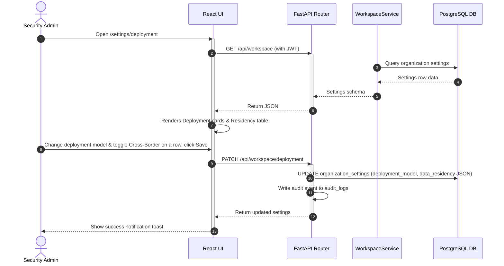
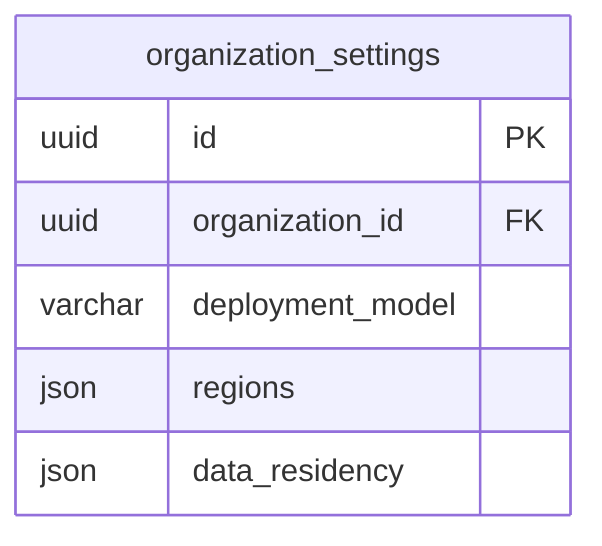

# Vajra — Deployment Settings Technical Specification

This document serves as the **single source of truth** for the **Deployment Settings** page of the Vajra DPDPA compliance platform. It provides the detailed frontend, backend, database, integration, and compliance specifications required to build, test, and maintain the deployment settings editor.

---

## 1. Module Overview

### 1.1 Purpose
The **Deployment Settings** page documents how and where personal data is stored and processed across the organization's cloud and physical systems.

### 1.2 Business Objective
To provide security and compliance teams with a structured catalog of system deployments, generating data residency maps and cross-border transfer disclosures to satisfy corporate security audits and regulatory inquiries.

### 1.3 DPDPA Compliance Objective
*   Provides verification mechanisms for **Section 16 cross-border transfer rules** (auditing transfers against prohibited or restricted country lists notified by the Government).
*   Demonstrates compliance with **Section 8 obligations** by documenting hosting jurisdictions and lawful bases for storing data outside India.

### 1.4 Architectural Context
The deployment config defines the scope for cross-border compliance checks inside the data inventory:



### 1.5 Target Users
*   **Cloud Architects & Security Admins**: Document active cloud architectures, database regions, and cross-border transfer bases.
*   **Auditors**: Verify that data storage locations align with regional guidelines.

---

## 2. DPDPA Mapping & Compliance Matrix

| DPDPA Section | Regulatory Requirement | Deployment Implementation |
| :--- | :--- | :--- |
| **Section 16** | Transfer of personal data outside India. | **Data Residency Matrix** requires administrators to explicitly tag any categories stored outside India, specifying the legal basis for transfer. |
| **Section 8(5)** | Duty to enforce security safeguards. | Documents hosting deployment models (Public Cloud, On-Premises) to verify infrastructure security scopes. |

---

## 3. End-to-End User Journey



---

## 4. Detailed Screen Specification

The Deployment Settings interface (Route: `/settings/deployment`) contains:

1.  **Deployment Model Cards**:
    *   *Selection Layout*: Clickable choice cards: Public Cloud, Private Cloud, Hybrid, On-Premises.
2.  **Hosting Regions Multi-Select**:
    *   Allows tagging active cloud datacenter locations (e.g. AWS ap-south-1 Mumbai, GCP asia-south2 Hyderabad).
3.  **Data Residency Matrix Grid**:
    *   A structured table displaying all registered data categories (Identity, Financial, Contact, Health).
    *   *Columns*: Data Category name, Stored Location/Region, Cross-border transfer toggle (Yes/No), and Legal Basis selection dropdown (e.g. Notice Consent, Contract Performance, Legal Obligation).
4.  **Actions Footer**:
    *   "Save Changes" (composes request parameters) and "Download Deployment Report" (PDF certificate).

---

## 5. Data Schemas

### 5.1 Deployment Update Request Schema

| Field Name | Type | Description | Example Value |
| :--- | :--- | :--- | :--- |
| `deployment_model` | String | Hosting infrastructure model | `"public_cloud"` |
| `regions` | List | Hosting cloud regions | `["AWS Mumbai", "GCP Hyderabad"]` |
| `data_residency` | JSON Array | Matrix detailing category scopes | See below |

#### 5.2 `data_residency` JSON Schema
```json
[
  {
    "category": "Financial",
    "region": "AWS Mumbai (India)",
    "cross_border": false,
    "legal_basis": "notice_consent"
  },
  {
    "category": "Identity",
    "region": "AWS Singapore",
    "cross_border": true,
    "legal_basis": "contract_fulfillment"
  }
]
```

---

## 6. Frontend Architecture

### 6.1 Page Component Structure
```
DeploymentSettings.tsx (Form Page)
  └── WorkspaceSettingsGate
        ├── Deployment model choice grid (Icon cards)
        ├── Hosting regions multi-select input
        └── Data Residency matrix table
              ├── Region input rows
              ├── Cross-border toggle switch
              └── Legal basis selection dropdown
```

---

## 7. Backend Architecture

### 7.1 Files & Modules Layout
*   **Router**: `app/routers/workspace.py` maps the `/deployment` patch route.
*   **Service**: `app/services/workspace_service.py` persists the deployment updates.

---

## 8. Database Design



---

## 9. QA Verification Matrix

### 9.1 Positive Test Cases
*   **TC-WD-01 (Deployment Save)**: Modify the hosting model to `hybrid` and add data residency mappings. Click Save. Verify organization settings rows update and audit log trails are created.
*   **TC-WD-02 (Cross-Border Flagging)**: Tag a category as stored in a foreign region with `cross_border: true`. Verify that the dashboard maps this category under active cross-border tracking widgets.

### 9.2 Negative Test Cases
*   **TC-WD-03 (Empty Model Validation)**: Attempt to save changes with an empty `deployment_model`. Verify the API returns validation errors.
*   **TC-WD-04 (Unauthorized Access)**: Request `/deployment` patching using a `viewer` token. Verify response is `403 Forbidden`.
