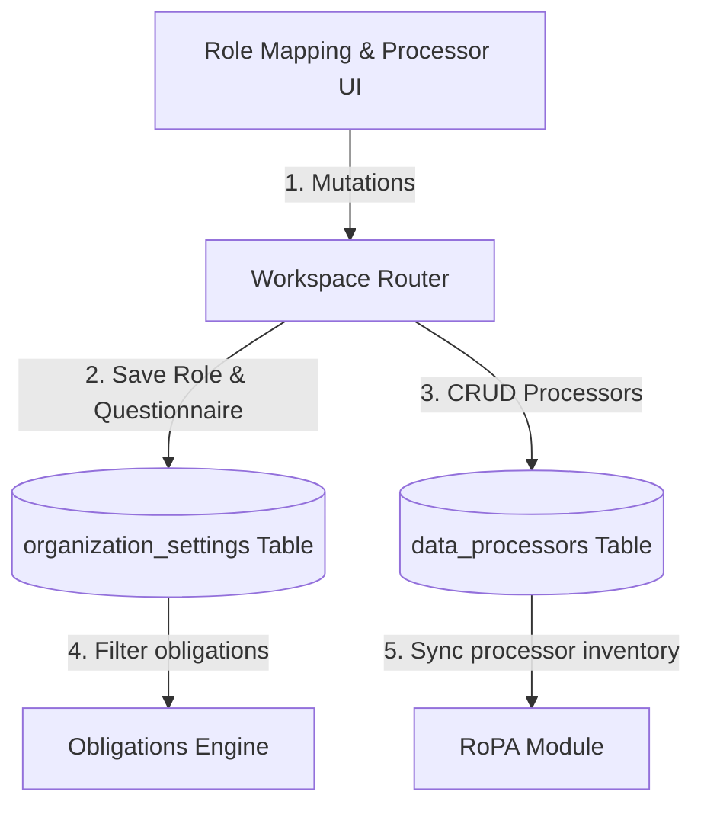
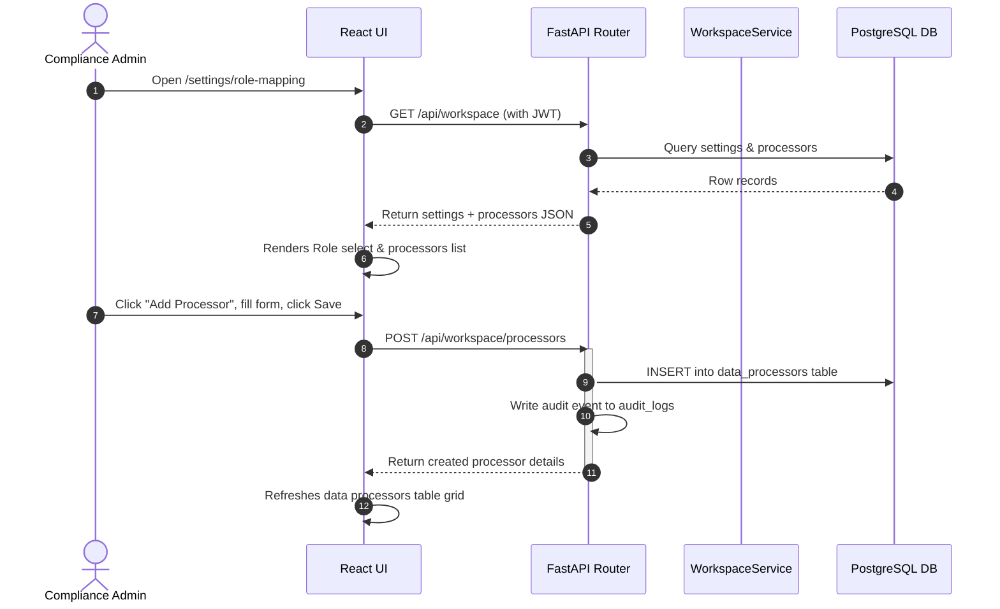
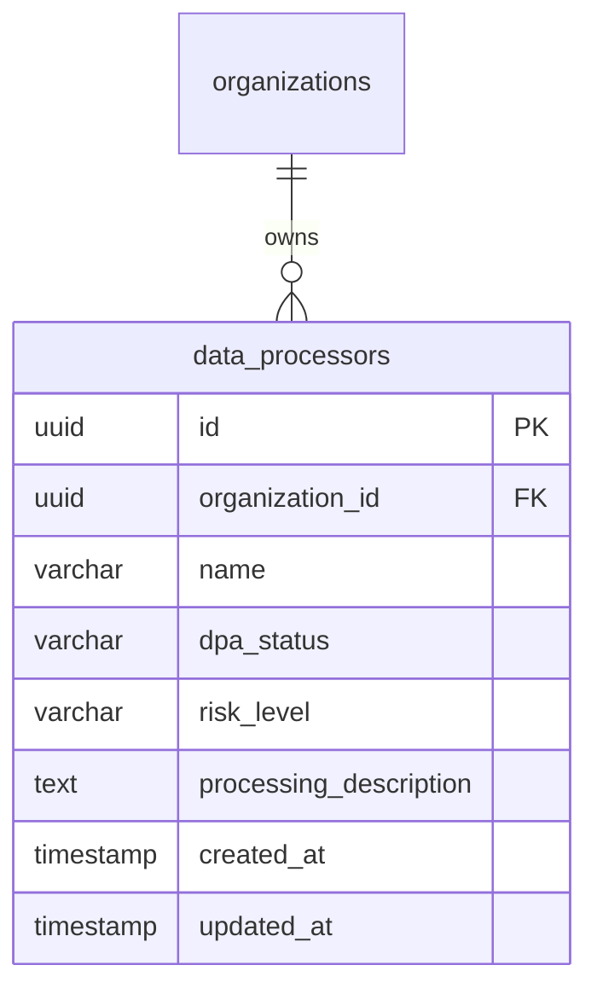

# Vajra — DPDP Role Mapping Technical Specification

This document serves as the **single source of truth** for the **DPDP Role Mapping** page of the Vajra DPDPA compliance platform. It provides the detailed frontend, backend, database, integration, and compliance specifications required to build, test, and maintain this role configuration pane.

---

## 1. Module Overview

### 1.1 Purpose
The **DPDP Role Mapping** page defines the organization's legal classification under the DPDPA (Data Fiduciary, Data Processor, or Significant Data Fiduciary) and maintains the inventory of third-party **Data Processors** engaged by the tenant.

### 1.2 Business Objective
To establish the legal boundaries of compliance obligations, map processor relationships, verify Data Protection Agreements (DPAs) are signed, and filter the global DPDPA obligation catalog to show only rules relevant to the organization's role.

### 1.3 DPDPA Compliance Objective
*   Fulfills **Section 8 obligations** regarding data processing agreements, ensuring that Data Fiduciaries only engage processors under valid, documented contracts.
*   Resolves obligation matrices for Significant Data Fiduciaries (Section 10) vs regular Data Fiduciaries.

### 1.4 Architectural Context
Role mapping configuration dynamically filters active obligations and connects data processor records to RoPA reporting databases:



### 1.5 Target Users
*   **Compliance Officers & DPOs**: Declare legal roles, answer role questionnaires, audit third-party processor lists, and verify DPA signatures.

---

## 2. DPDPA Mapping & Compliance Matrix

| DPDPA Section | Regulatory Requirement | Role Mapping Implementation |
| :--- | :--- | :--- |
| **Section 8(1)** | Data Fiduciary may engage, authorize or involve a Data Processor to process personal data on its behalf only under a valid contract. | **Data Processors Registry** tracks vendor names, DPA signature status (Signed / Pending / NA), risk levels, and descriptions. |
| **Section 10** | Stricter duties applied to Significant Data Fiduciaries. | Declaring the Significant Data Fiduciary role locks in Section 10 obligations across the entire portal. |

---

## 3. End-to-End User Journey



---

## 4. Detailed Screen Specification

The DPDP Role Mapping interface (Route: `/settings/role-mapping`) contains:

1.  **DPDP Role Selection**:
    *   *Inputs*: Radio selection choices: Data Fiduciary, Data Processor, Significant Data Fiduciary.
2.  **Role Assessment Questionnaire**:
    *   *Inputs*: Interactive questionnaire fields to document legal reasoning (e.g. Q9-Q10 triggers).
3.  **Data Processors Management Registry**:
    *   *Grid Columns*: Vendor Name, DPA Status badge (Signed, Pending, NA), Risk Level (Low, Medium, High), Processing Description.
    *   *Actions*:
        *   "Add Processor" button (opens a modal capturing Name, DPA Status, Risk level, and description).
        *   Edit / Delete icons next to each processor row.
4.  **Obligations Checklist Summary**:
    *   Displays a list of statutory requirements filtered by the declared role. Green checkmarks highlight fully automated items, grey capsules show manual obligations.

---

## 5. Data Schemas

### 5.1 DataProcessor Schema

| Field Name | Type | Description | Example Value |
| :--- | :--- | :--- | :--- |
| `id` | UUID | Unique processor identifier | `"a9a460b1-4bb2-466d-961f-cfa8448f2b1d"` |
| `name` | String | Vendor company name | `"AWS India"` |
| `dpa_status` | String | Status of data protection agreement | `"signed"` |
| `risk_level` | String | Risk categorization | `"low"` |
| `processing_description`| String | Summary of processing tasks | `"Cloud hosting for pharmacy databases."` |

---

## 6. Frontend Architecture

### 6.1 Page Component Structure
```
DPDPRoleMapping.tsx (Page Container)
  └── WorkspaceSettingsGate
        ├── Role Selection radio group
        ├── Role Assessment questionnaire
        ├── Data Processors table grid
        │     └── ProcessorFormModal (Create / Edit modal)
        └── Obligations Comparison checklist
```

---

## 7. Backend Architecture

### 7.1 Files & Modules Layout
*   **Router**: `app/routers/workspace.py` maps the `/role-mapping` and `/processors` routes.
*   **Service**: `app/services/workspace_service.py` houses role updates and processor CRUD handlers.

---

## 8. Database Design



---

## 9. API Design

### 9.1 Create Data Processor
*   **Method / Route**: `POST /api/workspace/processors`
*   **Request Body**:
    ```json
    {
      "name": "AWS India",
      "dpa_status": "signed",
      "risk_level": "low",
      "processing_description": "Cloud hosting for pharmacy databases."
    }
    ```
*   **Response Body (201 Created)**:
    ```json
    {
      "id": "a9a460b1-4bb2-466d-961f-cfa8448f2b1d",
      "name": "AWS India",
      "dpa_status": "signed",
      "risk_level": "low",
      "processing_description": "Cloud hosting for pharmacy databases."
    }
    ```

---

## 10. QA Verification Matrix

### 10.1 Positive Test Cases
*   **TC-RM-01 (Role Mapping Update)**: Modify DPDP role selection. Click Save. Verify organization settings updates and audit logs are written.
*   **TC-RM-02 (Processor CRUD)**: Create, update, and delete data processor rows. Verify DB operations execute correctly, and table views refresh dynamically.

### 10.2 Negative Test Cases
*   **TC-RM-03 (Duplicate Vendor Name)**: Attempt to create two data processors with the same name. Verify that database triggers block the transaction or throw validation errors.
*   **TC-RM-04 (Role write guard)**: Send a POST request to `/processors` using a `viewer` role token. Verify response is `403 Forbidden`.
