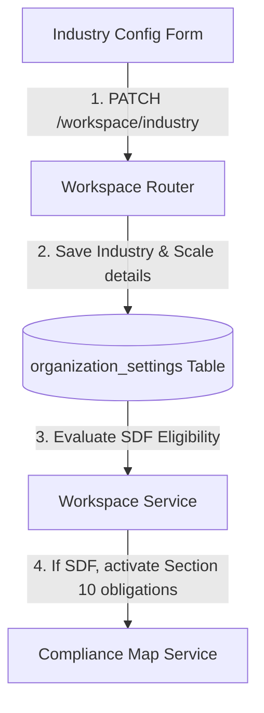
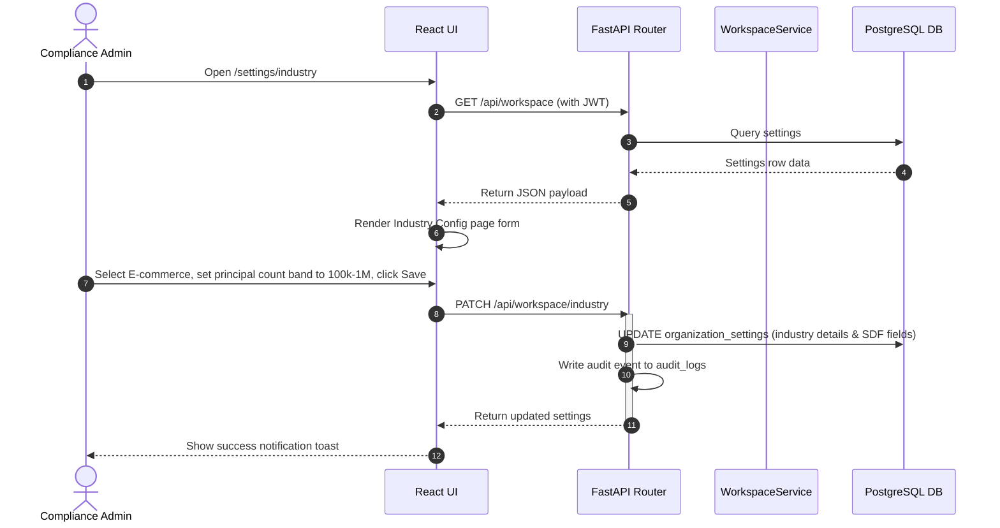
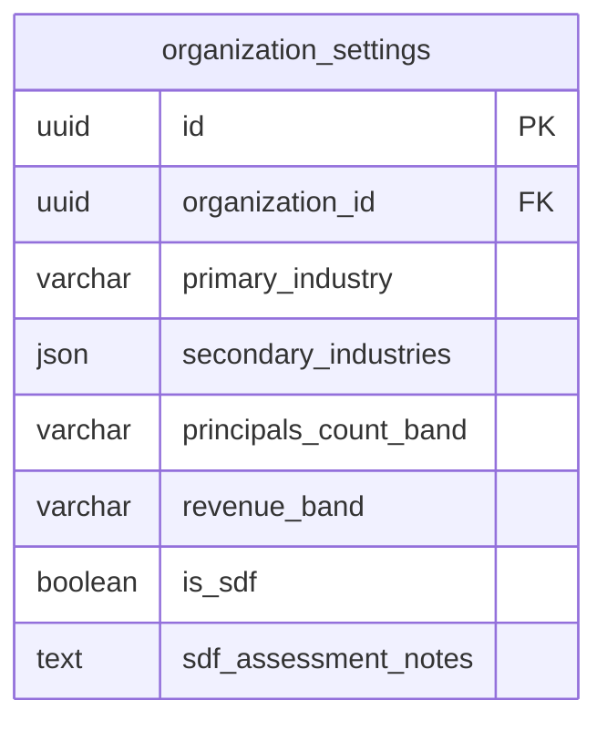

# Vajra — Industry Config Technical Specification

This document serves as the **single source of truth** for the **Industry Config** page of the Vajra DPDPA compliance platform. It provides the detailed frontend, backend, database, integration, and compliance specifications required to build, test, and maintain this settings pane.

---

## 1. Module Overview

### 1.1 Purpose
The **Industry Config** page identifies the tenant's primary business sector and maps their operational scale (data principal volumes and revenue) to determine regulatory triggers, such as **Significant Data Fiduciary (SDF)** obligations.

### 1.2 Business Objective
To establish the organization's compliance profile and industry benchmarks, enabling the platform to tailor statutory audits and highlight mandatory executive roles based on industry complexity and processing scale.

### 1.3 DPDPA Compliance Objective
*   Directly maps obligations under **Section 10 (Significant Data Fiduciary duties)**.
*   Assesses risk triggers (volume of data, sensitivity, risk of harm, public order threat) to determine if the organization must deploy stricter safeguards.

### 1.4 Architectural Context
The Industry Config writes parameters that dynamically change the role mapping status and compliance map obligations:



### 1.5 Target Users
*   **Compliance Officers & Legal Counsel**: Select industry sectors, assess SDF eligibility parameters, and document legal assessments.

### 1.6 Banking Industry Unlock
When **Primary Industry** is set to **Banking & Financial Services**, the platform unlocks the **Advanced Consent Management** sidebar section with five additional pages:
*   Bank Identifier Settings (`/consent/banking/identifiers`)
*   Journey & Channel Mapping (`/consent/banking/journeys`)
*   Branch Consent Capture (`/consent/banking/branch-capture`)
*   Merchant Consent Capture (`/consent/banking/merchant-capture`)
*   Customer Consent Registry (`/consent/banking/registry`)

This unlock is controlled by `organization_settings.primary_industry === 'Banking & Financial Services'` and activates banking-specific identifier types, journey configurations, OTP verification, and offline capture sessions. See `Advanced Consent Management/banking_overview.md` for full documentation.

---

## 2. DPDPA Mapping & Compliance Matrix

| DPDPA Section | Regulatory Requirement | Industry Config Implementation |
| :--- | :--- | :--- |
| **Section 10(1)** | Central Government may notify any Data Fiduciary as a Significant Data Fiduciary based on risk factors. | Captures data volume bands, revenue categories, and flags (risk to state sovereignty, electoral integrity, public order). |
| **Section 10(2)(a)** | SDF must appoint a Data Protection Officer based in India. | Activates mandatory validation checks for the DPO info section on the Workspace Info page if marked SDF. |
| **Section 10(2)(b)** | SDF must appoint an independent auditor to audit compliance. | Activates auditor reporting checkpoints in the safeguards and compliance views. |
| **Section 10(2)(c)** | SDF must conduct periodic Data Protection Impact Assessments (DPIAs). | Activates and unlocks access to the DPIA module in the portal. |

---

## 3. End-to-End User Journey



---

## 4. Detailed Screen Specification

The Industry Config interface (Route: `/settings/industry`) contains:

1.  **Primary Industry Selection**:
    *   *Inputs*: Dropdown options: Banking, Financial Services, E-commerce, Healthcare, Telecommunication, SaaS, Logistics, Education, Other.
2.  **Secondary Sectors**:
    *   *Inputs*: Multi-select chips to map overlapping sectors.
3.  **Scale & Volume Assessment**:
    *   *Inputs*:
        *   **Data Principals Count Band**: `< 10,000`, `10,000 - 100,000`, `100,000 - 1,000,000`, `1,000,000+`.
        *   **Annual Revenue Band**: `< ₹5 Cr`, `₹5 Cr - ₹50 Cr`, `₹50 Cr - ₹500 Cr`, `₹500 Cr+`.
4.  **Significant Data Fiduciary (SDF) Assessment**:
    *   *Inputs*: Checkbox flags representing Section 10 regulatory risk factors:
        *   Processing poses risk to sovereignty/integrity of India.
        *   Processing poses risk to electoral democracy.
        *   Processing poses risk to security of the State / public order.
        *   SDF Assessment notes (textarea to document legal counsel reasoning).
5.  **Actions Bar**:
    *   "Save Changes" (PATCH trigger) and "Export Configuration" (PDF summary).

---

## 5. Data Schemas

### 5.1 Industry Update Request Schema

| Field Name | Type | Description | Example Value |
| :--- | :--- | :--- | :--- |
| `primary_industry` | String | Core business segment | `"e_commerce"` |
| `secondary_industries` | List | Secondary business segments | `["retail", "logistics"]` |
| `principals_count_band`| String | Volume of data subjects | `"100k_to_1m"` |
| `revenue_band` | String | Annual revenue indicator | `"5cr_to_50cr"` |
| `is_sdf` | Boolean | Declared SDF status | `true` |
| `sdf_assessment_notes`| String | Legal justification notes | `"Assessment confirms SDF due to data volume."` |

---

## 6. Frontend Architecture

### 6.1 Page Component Structure
```
IndustryConfig.tsx (Form Page)
  └── WorkspaceSettingsGate
        ├── Primary Industry selection dropdown
        ├── Secondary Sectors chips input
        ├── Scale Assessment form (Data subjects & revenue dropdowns)
        └── SDF Assessment group (Risk checkboxes & text reasoning area)
```

---

## 7. Backend Architecture

### 7.1 Files & Modules Layout
*   **Router**: `app/routers/workspace.py` maps the `/industry` patch route.
*   **Service**: `app/services/workspace_service.py` manages database storage.

---

## 8. Database Design



---

## 9. QA Verification Matrix

### 9.1 Positive Test Cases
*   **TC-IC-01 (Save Industry Config)**: Set industry profile and scale bands. Click Save. Verify organization settings rows update and audit log entries are generated.
*   **TC-IC-02 (SDF Obligation Unlock)**: Set `is_sdf: true`. Navigate to compliance maps or obligations. Verify that Section 10 rules (DPIA, audit reviews) are unlocked and highlighted as mandatory.

### 9.2 Negative Test Cases
*   **TC-IC-03 (Invalid Band Value)**: Attempt to post an invalid count band (e.g. `millions_of_users`). Verify the API returns validation errors.
*   **TC-IC-04 (Role write guard)**: Send a patch request to `/industry` using a `viewer` role token. Verify response is `403 Forbidden`.
