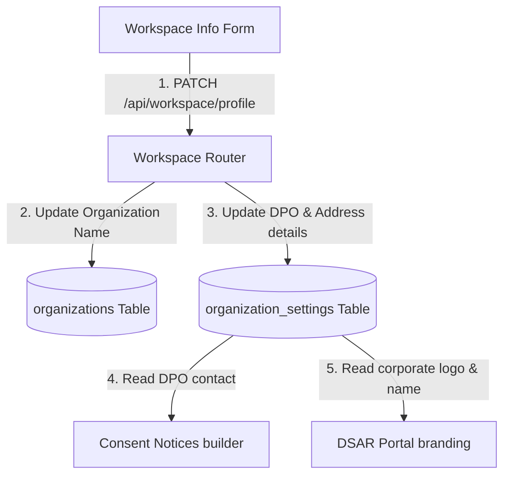
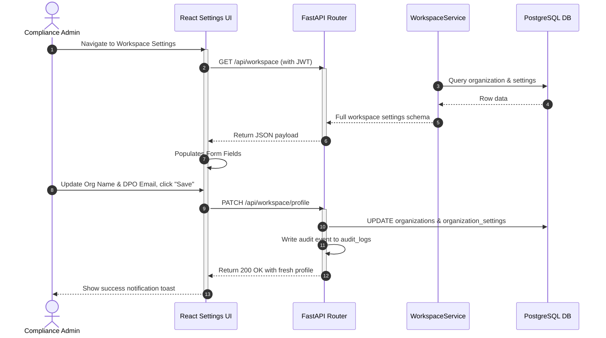
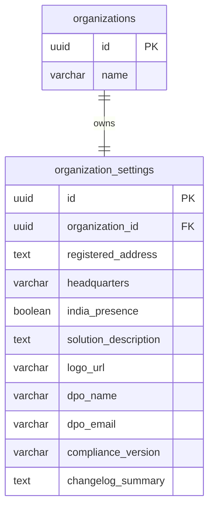

# Vajra — Workspace Info Technical Specification

This document serves as the **single source of truth** for the **Workspace Info** page of the Vajra DPDPA compliance platform. It provides the detailed frontend, backend, database, integration, and compliance specifications required to build, test, and maintain this settings pane.

---

## 1. Module Overview

### 1.1 Purpose
The **Workspace Info** page captures the legal corporate identity, product descriptions, and primary compliance contact details (including the Data Protection Officer) for each tenant.

### 1.2 Business Objective
To centralize organizational metadata in a single configuration view, allowing downstream compliance tools (consent banners, DSAR portals, auditor exports) to dynamically display consistent corporate details.

### 1.3 DPDPA Compliance Objective
*   Directly satisfies **Section 6(3)(c) notice requirements** to inform the data principal of the contact details of the DPO or other authorized representatives.
*   Satisfies **Section 8(9) requirements** to publish contact details of the Data Protection Officer or grievance redressal representative.

### 1.4 Architectural Context
Workspace Info writes to both the parent organization record and the organization settings table:



### 1.5 Target Users
*   **Compliance Managers & Admins**: Set corporate addresses, upload logos, configure DPO emails, and approve attestation changelogs.

---

## 2. DPDPA Mapping & Compliance Matrix

| DPDPA Section | Regulatory Requirement | Workspace Info Implementation |
| :--- | :--- | :--- |
| **Section 6(3)(c)** | Notice must contain contact details of the DPO or authorized representative. | Mandatory form fields for `dpo_name`, `dpo_email`, and `contact_email` feed active consent notice templates. |
| **Section 8(9)** | Obligation to publish the contact details of the DPO. | Forms a public-facing metadata endpoint consumed by the public DSAR intake portal. |
| **Section 11(1)** | Right to request grievance redressal. | Captures general grievance support channels and complaint website URLs. |

---

## 3. End-to-End User Journey



---

## 4. Detailed Screen Specification

The Workspace Info interface (Route: `/settings/workspace`) contains three sections:

1.  **Organization Profile Section**:
    *   *Inputs*: Organization Display Name (updates `organizations.name`), Solution Description (textarea mapping `solution_description`), Logo URL, Registered Address, Headquarters Region, India Presence checkbox.
2.  **Compliance & Attestation Settings**:
    *   *Inputs*: Compliance Version (e.g. `v1.0`), Changelog Summary (description of compliance state updates), and checkbox attestation declarations.
3.  **Data Protection Officer (DPO) Details**:
    *   *Inputs*: DPO Name, DPO Email, and Contact Website.
    *   *Validation*: Email field has a regex validator. Notice builders will flag warnings if the DPO email is left blank.
4.  **Actions Bar**:
    *   "Save Changes" (PATCH trigger) and "Export Profile Pack" (PDF summary of workspace details).

---

## 5. Data Schemas

### 5.1 Profile Update Request Payload

| Field Name | Type | Description | Example Value |
| :--- | :--- | :--- | :--- |
| `org_name` | String | Organization Display Name | `"Acme Retail India"` |
| `registered_address`| String | Official company address | `"402 Connaught Place, New Delhi"` |
| `headquarters` | String | Corporate HQ city | `"New Delhi"` |
| `india_presence` | Boolean | Operates physical office in India | `true` |
| `logo_url` | String | Public asset link for company logo | `"https://acme.in/assets/logo.png"` |
| `dpo_name` | String | Appointed Data Protection Officer | `"Amit Sharma"` |
| `dpo_email` | String | Official DPO email address | `"dpo@acme.in"` |

---

## 6. Frontend Architecture

### 6.1 Page Component Structure
```
WorkspaceInfo.tsx (Form Page)
  └── WorkspaceSettingsGate (Tenant validation check)
        ├── Organization Profile form group
        ├── Compliance & Attestations checklist
        └── DPO Contacts form group (Validates email/URLs)
```

---

## 7. Backend Architecture

### 7.1 Files & Modules Layout
*   **Router**: `app/routers/workspace.py` maps the `/profile` endpoint.
*   **Service**: `app/services/workspace_service.py` houses transaction logic for committing edits.

---

## 8. Database Design



---

## 9. QA Verification Matrix

### 9.1 Positive Test Cases
*   **TC-WS-01 (Profile Update)**: Modify organization name and DPO email. Click Save. Verify organizations and organization settings rows update in the database, and audit log entries are generated.
*   **TC-WS-02 (DynamicNotice Fallback)**: Blank out the DPO email field. Navigate to notice creation. Verify that notice validation checks raise `MISSING_DPO_CONTACT` warnings.

### 9.2 Negative Test Cases
*   **TC-WS-03 (Invalid DPO Email)**: Attempt to save profile changes with an invalid email address format (e.g., `dpo#acme`). Verify the API returns a `422 Unprocessable Entity` validation error.
*   **TC-WS-04 (Role write guard)**: Send a patch request to `/profile` using a `viewer` role token. Verify response is `403 Forbidden`.
